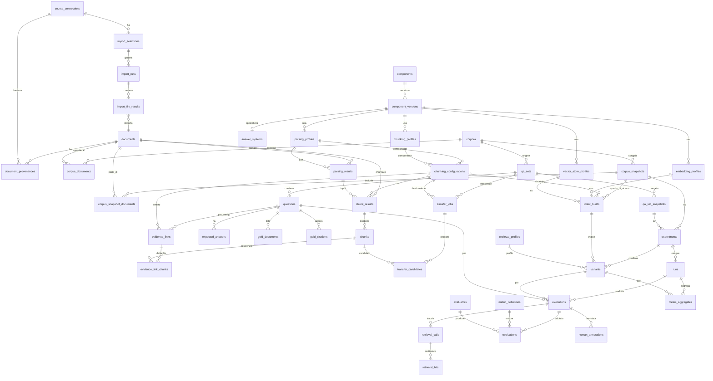

# Modello dati SQL — Piattaforma di benchmarking RAG

**Target:** PostgreSQL 15+
**Versione:** 1.1 — derivata da `REQUIREMENTS.md` §6 (Modello concettuale dei dati)

Questo documento traduce i sette blocchi concettuali della sezione 6 dei requisiti in uno schema relazionale concreto. Ogni tabella riporta campi, tipi PostgreSQL, chiavi e vincoli, con note sulle invarianti critiche.

**Cosa cambia nella 1.1.** Tre decisioni, motivate nel dettaglio ai punti in cui compaiono:

1. **Gli artefatti di pipeline sono per documento.** Parsing e chunking producono `parsing_results` e `chunk_results` con chiave (documento × configurazione). L'identità di un chunk non dipende dall'insieme di documenti in cui viene indicizzato, quindi il gold a livello chunk sopravvive a qualsiasi cambio di composizione del corpus.
2. **La configurazione di chunking è un'entità.** `chunking_configurations` materializza la coppia (profilo di parsing, profilo di chunking): è la dimensione di confrontabilità di §3.1 e l'unica cosa il cui cambiamento costa lavoro umano.
3. **Lo snapshot nasce con la configurazione di popolamento del vector DB.** È deduplicato per composizione e vive in `index_builds`, dove definisce lo spazio di ricerca. La tabella `chunk_sets` della 1.0, che mescolava snapshot e configurazione, non esiste più.

---

## Convenzioni comuni

| Convenzione | Scelta |
|---|---|
| Chiavi primarie | `UUID` (default `gen_random_uuid()`), salvo enumerazioni brevi |
| Timestamp | `TIMESTAMPTZ`, default `now()` |
| Campi di audit | `created_at`, `updated_at` su tutte le entità mutabili |
| Metadati arbitrari / parametri | `JSONB` |
| Hash di contenuto / configurazione | `TEXT` (hex sha-256), sempre indicizzato |
| Enumerazioni | tipi `ENUM` PostgreSQL nativi (estendibili con `ALTER TYPE`) |
| Immutabilità | garantita a livello applicativo + trigger opzionale che blocca `UPDATE` sugli snapshot |
| Naming | tabelle al plurale `snake_case`; FK `<entita>_id` |

**Tipi ENUM previsti**

```sql
CREATE TYPE source_type        AS ENUM ('upload', 'filesystem', 's3', 'sharepoint', 'confluence');
CREATE TYPE auth_method         AS ENUM ('none', 'api_key', 'token', 'basic', 'oauth2');
CREATE TYPE import_status       AS ENUM ('pending', 'running', 'succeeded', 'failed', 'partial');
CREATE TYPE file_outcome        AS ENUM ('imported', 'skipped_duplicate', 'skipped_unsupported', 'failed');
CREATE TYPE document_status     AS ENUM ('pending', 'fetching', 'stored', 'failed');
CREATE TYPE artifact_status     AS ENUM ('pending', 'running', 'ready', 'failed');
CREATE TYPE component_type      AS ENUM ('source', 'parser', 'chunker', 'embedder', 'vector_store', 'reranker', 'answer_system', 'judge');
CREATE TYPE runtime_type        AS ENUM ('builtin', 'http');
CREATE TYPE evidence_link_status AS ENUM ('to_review', 'confirmed', 'not_found');
CREATE TYPE relevance_grade     AS ENUM ('sufficient', 'supporting');
CREATE TYPE transfer_status     AS ENUM ('pending', 'running', 'completed', 'cancelled');
CREATE TYPE confidence_band     AS ENUM ('high', 'medium', 'low');
CREATE TYPE experiment_type     AS ENUM ('retrieval', 'qa');
CREATE TYPE execution_status    AS ENUM ('pending', 'running', 'succeeded', 'failed', 'skipped');
CREATE TYPE retrieval_stage     AS ENUM ('dense', 'sparse', 'fused', 'reranked', 'final');
CREATE TYPE retrieval_scope     AS ENUM ('retrieved', 'in_context', 'cited');
CREATE TYPE metric_family       AS ENUM ('retrieval', 'answer', 'efficiency', 'robustness');
CREATE TYPE metric_level        AS ENUM ('document', 'chunk');
CREATE TYPE evaluator_kind      AS ENUM ('deterministic', 'llm_judge', 'human');
```

> `document_status` descrive il ciclo di vita dell'**acquisizione** di un file (scaricato, hashato, salvato). `artifact_status` descrive il ciclo di vita di un **artefatto di pipeline** ed è condiviso da `parsing_results`, `chunk_results` e `index_builds`. Nella 1.0 un unico `ingestion_status` copriva entrambi, con valori (`parsing`, `chunking`) che non hanno senso su un documento.

---

## Blocco 1 — Sorgenti e acquisizione (§6.1)

### `source_connections`
Configurazione riusabile verso un sistema documentale. Memorizza solo un **riferimento** alla credenziale, mai il valore (RT-S01, RT-S04). L'accesso può essere non autenticato oppure basato su token/API key (es. Confluence) o su flusso **OAuth2.0**; tutti i segreti (token, client secret, refresh token) restano nel secret store, referenziati per nome.

| Campo | Tipo | Vincoli | Note |
|---|---|---|---|
| `id` | UUID | PK | |
| `name` | TEXT | NOT NULL | etichetta leggibile |
| `type` | source_type | NOT NULL | upload / filesystem / s3 / sharepoint / confluence |
| `endpoint` | TEXT | | URL/host della sorgente |
| `root_path` | TEXT | | root o site/library |
| `auth_method` | auth_method | NOT NULL DEFAULT 'none' | modalità di autenticazione: none / api_key / token / basic / oauth2 |
| `credential_ref` | TEXT | | nome della variabile d'ambiente/segreto (token, api key, password) |
| `oauth_config` | JSONB | NOT NULL DEFAULT '{}' | parametri OAuth2.0 non segreti: authorization_url, token_url, scopes, client_id; i segreti (client_secret, refresh_token) restano nel secret store, referenziati per nome |
| `config` | JSONB | NOT NULL DEFAULT '{}' | parametri specifici dell'adapter |
| `created_at` | TIMESTAMPTZ | NOT NULL DEFAULT now() | |
| `updated_at` | TIMESTAMPTZ | NOT NULL DEFAULT now() | |
| | | CHECK (auth_method = 'none' OR credential_ref IS NOT NULL) | se autenticato, serve un riferimento al segreto |

### `import_selections`
Cosa importare da una connessione; unità **ri-sincronizzabile** (RF-S09).

| Campo | Tipo | Vincoli | Note |
|---|---|---|---|
| `id` | UUID | PK | |
| `connection_id` | UUID | FK → source_connections, NOT NULL | |
| `name` | TEXT | NOT NULL | |
| `paths` | JSONB | NOT NULL DEFAULT '[]' | percorsi/cartelle/siti selezionati |
| `recursive` | BOOLEAN | NOT NULL DEFAULT false | ricorsione sulle cartelle |
| `filters` | JSONB | NOT NULL DEFAULT '{}' | pattern su nome/estensione |
| `created_at` | TIMESTAMPTZ | NOT NULL DEFAULT now() | |
| `updated_at` | TIMESTAMPTZ | NOT NULL DEFAULT now() | |

### `import_runs`
Un passaggio di acquisizione, con riepilogo e stato denormalizzato da Temporal (RT-O07).

| Campo | Tipo | Vincoli | Note |
|---|---|---|---|
| `id` | UUID | PK | |
| `selection_id` | UUID | FK → import_selections, NOT NULL | |
| `workflow_id` | TEXT | UNIQUE | ID deterministico Temporal (RT-O01) |
| `status` | import_status | NOT NULL DEFAULT 'pending' | |
| `counts` | JSONB | NOT NULL DEFAULT '{}' | {imported, skipped, failed} |
| `started_at` | TIMESTAMPTZ | | |
| `finished_at` | TIMESTAMPTZ | | |
| `created_at` | TIMESTAMPTZ | NOT NULL DEFAULT now() | |

### `import_file_results`
Esito per singolo file dentro un run (RF-S07, RF-S11).

| Campo | Tipo | Vincoli | Note |
|---|---|---|---|
| `id` | UUID | PK | |
| `import_run_id` | UUID | FK → import_runs, NOT NULL | |
| `source_uri` | TEXT | NOT NULL | URI/percorso alla sorgente |
| `document_id` | UUID | FK → documents, NULL | popolato se importato |
| `outcome` | file_outcome | NOT NULL | |
| `error_reason` | TEXT | | motivo del fallimento/skip |
| `created_at` | TIMESTAMPTZ | NOT NULL DEFAULT now() | |

### `document_provenances`
Lega documento ↔ connessione: relazione **molti-a-molti** (RF-S06). Lo stesso contenuto può provenire da più sorgenti.

| Campo | Tipo | Vincoli | Note |
|---|---|---|---|
| `id` | UUID | PK | |
| `document_id` | UUID | FK → documents, NOT NULL | |
| `connection_id` | UUID | FK → source_connections, NOT NULL | |
| `original_uri` | TEXT | NOT NULL | percorso/URI originale (RF-S05) |
| `native_id` | TEXT | | identificativo nativo alla sorgente |
| `source_modified_at` | TIMESTAMPTZ | | data modifica alla sorgente |
| `created_at` | TIMESTAMPTZ | NOT NULL DEFAULT now() | |
| | | UNIQUE (document_id, connection_id, original_uri) | evita doppie provenienze identiche |

---

## Blocco 2 — Corpus e documenti (§6.2)

Tre livelli distinti, con ruoli che non vanno confusi: la **libreria** dei file acquisiti (`documents`), il **raggruppamento organizzativo** che evolve nel tempo (`corpora`), la **selezione congelata** su cui si misura (`corpus_snapshots`).

### `documents`
Il file, identificato per **hash del contenuto**. L'identità **non dipende dal parse** (RF-S10). Immutabile: un file aggiornato alla sorgente genera un nuovo documento.

| Campo | Tipo | Vincoli | Note |
|---|---|---|---|
| `id` | UUID | PK | |
| `content_hash` | TEXT | NOT NULL UNIQUE | sha-256 del contenuto; chiave di dedup |
| `filename` | TEXT | NOT NULL | nome file originale |
| `mime_type` | TEXT | NOT NULL | application/pdf, ...docx |
| `size_bytes` | BIGINT | NOT NULL | |
| `storage_uri` | TEXT | NOT NULL | riferimento a object storage (RT-O02) |
| `status` | document_status | NOT NULL DEFAULT 'pending' | stato di acquisizione (RF-C04) |
| `error` | TEXT | | motivo se `failed` |
| `metadata` | JSONB | NOT NULL DEFAULT '{}' | metadati arbitrari filtrabili (RF-C02) |
| `created_at` | TIMESTAMPTZ | NOT NULL DEFAULT now() | |

> **Perché lo stato sta qui.** Fetch, hash e upload sono proprietà del file, non della sua appartenenza a un corpus: lo stesso documento in due corpora non ha due stati di acquisizione diversi. Lo stato di parsing e chunking non sta né qui né su `corpus_documents`, ma su `parsing_results` / `chunk_results`, perché esiste **per configurazione**. L'avanzamento di un corpus (RF-C04) è un aggregato sulle appartenenze.

### `corpora`
Raggruppamento logico e **mutabile** di documenti (RF-C01): tipicamente un'area organizzativa — "documenti reparto cyber", "reparto acquisti". Vive nel tempo: acquisisce e perde documenti.

| Campo | Tipo | Vincoli | Note |
|---|---|---|---|
| `id` | UUID | PK | |
| `name` | TEXT | NOT NULL | |
| `description` | TEXT | | |
| `created_at` | TIMESTAMPTZ | NOT NULL DEFAULT now() | |
| `updated_at` | TIMESTAMPTZ | NOT NULL DEFAULT now() | |

### `corpus_documents`
Appartenenza corrente documento ↔ corpus (molti-a-molti). Rimuovere qui non invalida gli snapshot (RF-C05): è un "rimuovi dal corpus", non un "elimina documento".

| Campo | Tipo | Vincoli | Note |
|---|---|---|---|
| `corpus_id` | UUID | FK → corpora, NOT NULL | |
| `document_id` | UUID | FK → documents, NOT NULL | |
| `added_at` | TIMESTAMPTZ | NOT NULL DEFAULT now() | |
| | | PK (corpus_id, document_id) | |

### `corpus_snapshots`
Selezione **immutabile e congelata** di documenti di un corpus: definisce lo **spazio di ricerca** di un indice (RF-C03). Creato contestualmente a una configurazione di popolamento del vector DB (RF-P09) e **deduplicato per composizione**.

| Campo | Tipo | Vincoli | Note |
|---|---|---|---|
| `id` | UUID | PK | |
| `corpus_id` | UUID | FK → corpora, NOT NULL | |
| `label` | TEXT | NOT NULL | nome/versione dello snapshot |
| `document_count` | INTEGER | NOT NULL | numerosità congelata |
| `composition_hash` | TEXT | NOT NULL | sha-256 sugli id documento **ordinati** |
| `frozen_at` | TIMESTAMPTZ | NOT NULL DEFAULT now() | |
| | | UNIQUE (corpus_id, composition_hash) | dedup per contenuto |

> **Perché il dedup è obbligatorio.** Lo snapshot entra nel significato della metrica — `recall@5` su 50 documenti e su 200 non sono la stessa misura, i distrattori sono parte di ciò che si misura — e quindi entra nella regola di confrontabilità. Se ogni configurazione di popolamento creasse uno snapshot nuovo, dopo un mese si avrebbero venti snapshot con la stessa composizione e venti gruppi non confrontabili di esperimenti che sono invece lo stesso esperimento. La creazione va implementata come **get-or-create** su `(corpus_id, composition_hash)`, mai come insert.

### `corpus_snapshot_documents`
Composizione immutabile dello snapshot (mai modificata dopo il freeze).

| Campo | Tipo | Vincoli | Note |
|---|---|---|---|
| `snapshot_id` | UUID | FK → corpus_snapshots, NOT NULL | |
| `document_id` | UUID | FK → documents, ON DELETE RESTRICT, NOT NULL | un documento congelato non si cancella |
| | | PK (snapshot_id, document_id) | |

**Invariante.** Un documento appartiene a uno o più snapshot ma non viene mai modificato. Rimuoverlo da un corpus non lo rimuove dagli snapshot che lo contengono.

**Ritenzione.** `ON DELETE RESTRICT` protegge la riga in database, ma la garanzia va estesa all'**object storage**: un documento referenziato da uno snapshot non va mai cancellato fisicamente, altrimenti "gli snapshot fanno fede" resta vero nello schema e falso alla rilettura di un chunk.

---

## Blocco 3 — Pipeline (§6.3)

I profili di parsing/chunking/embedding/vector store referenziano una **versione di componente** (blocco 4) e memorizzano i parametri con un `config_hash` per il caching content-addressed (RF-P07).

### `parsing_profiles`

| Campo | Tipo | Vincoli | Note |
|---|---|---|---|
| `id` | UUID | PK | |
| `name` | TEXT | NOT NULL | |
| `component_version_id` | UUID | FK → component_versions, NOT NULL | |
| `params` | JSONB | NOT NULL DEFAULT '{}' | validati contro lo schema del componente |
| `config_hash` | TEXT | NOT NULL | hash(component_version + params) |
| `created_at` | TIMESTAMPTZ | NOT NULL DEFAULT now() | |
| | | UNIQUE (config_hash) | |

### `chunking_profiles`
Include la politica di filtro header/footer/indice (RF-P03) e la politica sulle immagini (RF-P02).

| Campo | Tipo | Vincoli | Note |
|---|---|---|---|
| `id` | UUID | PK | |
| `name` | TEXT | NOT NULL | |
| `component_version_id` | UUID | FK → component_versions, NOT NULL | |
| `strategy` | TEXT | NOT NULL | fixed / recursive / semantic ... |
| `chunk_size` | INTEGER | | |
| `overlap` | INTEGER | | |
| `params` | JSONB | NOT NULL DEFAULT '{}' | filtro header/footer, policy immagini |
| `config_hash` | TEXT | NOT NULL UNIQUE | |
| `created_at` | TIMESTAMPTZ | NOT NULL DEFAULT now() | |

### `embedding_profiles`
Supporto a modelli testuali, di immagine e multi-vettore (RF-P04).

| Campo | Tipo | Vincoli | Note |
|---|---|---|---|
| `id` | UUID | PK | |
| `name` | TEXT | NOT NULL | |
| `component_version_id` | UUID | FK → component_versions, NOT NULL | |
| `modality` | TEXT | NOT NULL DEFAULT 'text' | text / image / multi_vector |
| `dimensions` | INTEGER | | dimensione del vettore |
| `params` | JSONB | NOT NULL DEFAULT '{}' | |
| `config_hash` | TEXT | NOT NULL UNIQUE | |
| `created_at` | TIMESTAMPTZ | NOT NULL DEFAULT now() | |

### `vector_store_profiles`
Pinecone / Qdrant / pgvector con parametri d'indice (RF-P05).

| Campo | Tipo | Vincoli | Note |
|---|---|---|---|
| `id` | UUID | PK | |
| `name` | TEXT | NOT NULL | |
| `component_version_id` | UUID | FK → component_versions, NOT NULL | |
| `index_params` | JSONB | NOT NULL DEFAULT '{}' | metrica, dimensione, HNSW... |
| `config_hash` | TEXT | NOT NULL UNIQUE | |
| `created_at` | TIMESTAMPTZ | NOT NULL DEFAULT now() | |

### `retrieval_profiles`
Configurazione di retrieval completa (RF-P06). Referenziato dalle varianti, non è uno stadio materializzato.

| Campo | Tipo | Vincoli | Note |
|---|---|---|---|
| `id` | UUID | PK | |
| `name` | TEXT | NOT NULL | |
| `top_k` | INTEGER | NOT NULL | |
| `pre_rerank_k` | INTEGER | | candidati pre-rerank |
| `strategy` | TEXT | NOT NULL | dense / sparse / hybrid / multi_vector |
| `fusion_weights` | JSONB | | pesi di fusione |
| `mmr` | JSONB | | parametri MMR |
| `score_threshold` | DOUBLE PRECISION | | soglia di score |
| `metadata_filters` | JSONB | | filtri sui metadati |
| `query_transforms` | JSONB | | HyDE, multi-query, riscrittura |
| `reranker_version_id` | UUID | FK → component_versions, NULL | |
| `context_policy` | JSONB | | composizione del contesto |
| `config_hash` | TEXT | NOT NULL UNIQUE | |
| `created_at` | TIMESTAMPTZ | NOT NULL DEFAULT now() | |

### `parsing_results`
Output di un parser su un **singolo documento**. Chiave di cache: **documento + profilo di parsing** (RF-P07).

| Campo | Tipo | Vincoli | Note |
|---|---|---|---|
| `id` | UUID | PK | |
| `document_id` | UUID | FK → documents, NOT NULL | |
| `parsing_profile_id` | UUID | FK → parsing_profiles, NOT NULL | |
| `output_uri` | TEXT | NOT NULL | parse su object storage |
| `cache_key` | TEXT | NOT NULL UNIQUE | hash(document.content_hash + profile.config_hash) |
| `status` | artifact_status | NOT NULL DEFAULT 'pending' | |
| `error` | TEXT | | |
| `created_at` | TIMESTAMPTZ | NOT NULL DEFAULT now() | |
| | | UNIQUE (document_id, parsing_profile_id) | un solo parse per coppia |
| | | UNIQUE (id, parsing_profile_id) | appoggio per la FK composita di `chunk_results` |

### `chunking_configurations`
La **"configurazione di chunking"** di §3.1, materializzata: la coppia (profilo di parsing, profilo di chunking). È la dimensione di confrontabilità del gold a livello chunk e l'unità a cui punta `evidence_links`.

| Campo | Tipo | Vincoli | Note |
|---|---|---|---|
| `id` | UUID | PK | |
| `name` | TEXT | NOT NULL | etichetta leggibile, es. `docling + recursive512` |
| `parsing_profile_id` | UUID | FK → parsing_profiles, NOT NULL | |
| `chunking_profile_id` | UUID | FK → chunking_profiles, NOT NULL | |
| `config_hash` | TEXT | NOT NULL UNIQUE | hash(parsing.config_hash + chunking.config_hash) |
| `created_at` | TIMESTAMPTZ | NOT NULL DEFAULT now() | |
| | | UNIQUE (parsing_profile_id, chunking_profile_id) | una sola configurazione per coppia |
| | | UNIQUE (id, parsing_profile_id) | appoggio per la FK composita di `chunk_results` |

> **Perché è un'entità e non solo due colonne.** È il livello a cui vive il gold: `evidence_links` ci punta, quindi un legame confermato resta valido al variare di embedder, vector store, top-k e composizione del corpus. È anche la chiave di raggruppamento della leaderboard (RF-L01) e del vincolo UI (RT-U02). Non va collassata dentro `index_builds`: se il gold dipendesse dall'indice, cambiare embedder costerebbe una ri-annotazione.

### `chunk_results`
Output di un chunker su un **singolo documento**, a partire da un parse. Chiave di cache: **documento + configurazione di chunking**.

| Campo | Tipo | Vincoli | Note |
|---|---|---|---|
| `id` | UUID | PK | |
| `document_id` | UUID | FK → documents, NOT NULL | |
| `chunking_configuration_id` | UUID | FK → chunking_configurations, NOT NULL | |
| `parsing_result_id` | UUID | FK (composita, sotto), NOT NULL | il parse in input |
| `parsing_profile_id` | UUID | NOT NULL | ridondante per la coerenza dichiarativa |
| `cache_key` | TEXT | NOT NULL UNIQUE | hash(document.content_hash + configuration.config_hash) |
| `chunk_count` | INTEGER | NOT NULL DEFAULT 0 | |
| `status` | artifact_status | NOT NULL DEFAULT 'pending' | |
| `error` | TEXT | | |
| `created_at` | TIMESTAMPTZ | NOT NULL DEFAULT now() | |
| | | UNIQUE (document_id, chunking_configuration_id) | un solo risultato per coppia |
| | | FK (parsing_result_id, parsing_profile_id) → parsing_results (id, parsing_profile_id) | |
| | | FK (chunking_configuration_id, parsing_profile_id) → chunking_configurations (id, parsing_profile_id) | |

> **Le due FK composite** garantiscono in modo dichiarativo che il parse in input appartenga allo stesso profilo di parsing dichiarato dalla configurazione. Costano due unique index di appoggio ed evitano un check applicativo che prima o poi si dimentica.

> **Perché il chunking è per documento.** Chunkare è un'operazione document-local: si prende il parse di un file e si spezza. Il risultato non dipende da quali altri documenti stanno nell'insieme. Ancorarlo a uno snapshot — come faceva `chunk_sets` nella 1.0 — produceva tre effetti indesiderati: (a) aggiungere un documento al corpus generava chunk con id nuovi e **invalidava il gold** anche a parsing e chunking invariati; (b) snapshot sovrapposti duplicavano lavoro e storage, contro RF-P07; (c) due varianti con la stessa configurazione di chunking su snapshot diversi risultavano non confrontabili a livello chunk pur essendolo. Effetto collaterale positivo: l'ispezione dei chunk (RF-P08) è possibile su un singolo documento, quindi si può provare una configurazione su tre file prima di applicarla a duecento.

> **Limite dichiarato.** Lo schema assume chunker **document-scoped**. Un chunker che deduplica boilerplate guardando l'intero corpus non è cacheabile per documento; la sua ammissibilità è governata da `capabilities.scope` sulla versione di componente (RF-R03), e in v1 sono ammessi solo chunker `document`. Il filtro di header/footer/indice (RF-P03) è per-documento e non è un'eccezione.

### `chunks`
Unità indicizzabile, con testo, modalità e metadati (§6.3). I vettori risiedono nel vector store esterno; qui solo testo e metadati. Il documento è determinato dal `chunk_result`.

| Campo | Tipo | Vincoli | Note |
|---|---|---|---|
| `id` | UUID | PK | |
| `chunk_result_id` | UUID | FK → chunk_results, NOT NULL | implica documento e configurazione |
| `ordinal` | INTEGER | NOT NULL | posizione nel documento (segnale posizionale) |
| `text` | TEXT | NOT NULL | |
| `modality` | TEXT | NOT NULL DEFAULT 'text' | text / image / table |
| `metadata` | JSONB | NOT NULL DEFAULT '{}' | pagina, bbox, header path... |
| `text_normalized` | TEXT | | forma normalizzata (RT-M01) per il matching |
| | | UNIQUE (chunk_result_id, ordinal) | |

> L'identità di un chunk dipende solo da (documento, configurazione di chunking, posizione). È questa stabilità che rende gratuito aggiungere documenti a un corpus: i chunk dei documenti già presenti sono gli stessi, quindi `evidence_link_chunks` resta valido.

### `index_builds`
La **configurazione di popolamento del vector DB**: snapshot × configurazione di chunking × embedder × vector store. Identificata da un'impronta dell'intera catena.

| Campo | Tipo | Vincoli | Note |
|---|---|---|---|
| `id` | UUID | PK | |
| `name` | TEXT | NOT NULL | es. `Cyber · docling+rec512 · emb-3-large · Qdrant` |
| `corpus_snapshot_id` | UUID | FK → corpus_snapshots, NOT NULL | lo spazio di ricerca |
| `chunking_configuration_id` | UUID | FK → chunking_configurations, NOT NULL | |
| `embedding_profile_id` | UUID | FK → embedding_profiles, NOT NULL | |
| `vector_store_profile_id` | UUID | FK → vector_store_profiles, NOT NULL | |
| `chain_fingerprint` | TEXT | NOT NULL UNIQUE | hash(snapshot.composition_hash + configuration + embedding + vector_store) |
| `external_index_ref` | TEXT | NOT NULL | nome/namespace collection nel vector DB |
| `status` | artifact_status | NOT NULL DEFAULT 'pending' | |
| `workflow_id` | TEXT | UNIQUE | ID Temporal (RT-O01) |
| `created_at` | TIMESTAMPTZ | NOT NULL DEFAULT now() | |

> **È qui che entra lo snapshot**, perché lo spazio di ricerca è una proprietà dell'indice e non dell'esperimento: così il `chain_fingerprint` identifica davvero tutto ciò da cui dipende il contenuto dell'indice, e un esperimento diventa una scelta fra indici già costruiti anziché l'innesco di venti minuti di parsing ed embedding.

> **Definire una configurazione di popolamento** è una singola azione utente che esegue quattro get-or-create content-addressed: snapshot (per `composition_hash`), configurazione di chunking (per `config_hash`), `chunk_results` dei documenti dello snapshot (per `cache_key`), index build (per `chain_fingerprint`). Ripetere la stessa scelta non crea nulla di nuovo e resta confrontabile con quanto già misurato.

**Insieme dei chunk di un indice.** Non è materializzato: è la query `chunks → chunk_results` filtrata per `chunking_configuration_id` dell'index build e per i `document_id` in `corpus_snapshot_documents`. Il conteggio è un aggregato su `chunk_results.chunk_count`.

**Invariante.** Ogni artefatto è immutabile e riusabile: variare un parametro a valle non invalida gli stadi a monte, e variare la composizione dello snapshot non invalida i chunk dei documenti in comune.

### `materialization_runs`
La copia denormalizzata di **una materializzazione di chunk lanciata dall'utente** (RT-O07). I `chunk_results` da soli non dicono *quale richiesta* li ha generati né quanti ne mancano: questa riga sì, così la UI mostra l'avanzamento (RT-U05) senza interrogare Temporal a ogni polling.

| Campo | Tipo | Vincoli | Note |
|---|---|---|---|
| `id` | UUID | PK | |
| `chunking_configuration_id` | UUID | FK → chunking_configurations, NOT NULL | |
| `corpus_id` | UUID | FK → corpora, NULL | informativo, per la UI |
| `workflow_id` | TEXT | NOT NULL UNIQUE | ID Temporal deterministico (RT-O01) |
| `status` | artifact_status | NOT NULL DEFAULT 'pending' | riusa l'ENUM esistente |
| `document_count` | INTEGER | NOT NULL | |
| `progress` | JSONB | NOT NULL DEFAULT '{}' | `{ready, failed, cached, pending}` |
| `started_at` | TIMESTAMPTZ | | |
| `finished_at` | TIMESTAMPTZ | | |
| `created_at` | TIMESTAMPTZ | NOT NULL DEFAULT now() | |

> **Stato autorevole in Temporal.** `status`/`progress` sono una copia per la reattività della UI, aggiornata in modo incrementale dalle activity del run; la verità resta la history del workflow. È la stessa denormalizzazione che RT-O07 prescrive per `import_runs`, `runs` e `index_builds`, applicata alla materializzazione dei chunk.

---

## Blocco 4 — Componenti / Registry (§6.4)

### `components`
Identità logica: **tipo + chiave** (es. `parser/azure_di`). Registrabile senza modifiche al codice (RF-R01).

| Campo | Tipo | Vincoli | Note |
|---|---|---|---|
| `id` | UUID | PK | |
| `type` | component_type | NOT NULL | parser, chunker, embedder, ... |
| `key` | TEXT | NOT NULL | es. `azure_di` |
| `display_name` | TEXT | NOT NULL | |
| `created_at` | TIMESTAMPTZ | NOT NULL DEFAULT now() | |
| | | UNIQUE (type, key) | |

### `component_versions`
Implementazione concreta. Più versioni attive contemporaneamente (RF-R06).

| Campo | Tipo | Vincoli | Note |
|---|---|---|---|
| `id` | UUID | PK | |
| `component_id` | UUID | FK → components, NOT NULL | |
| `version` | TEXT | NOT NULL | semver o etichetta |
| `runtime` | runtime_type | NOT NULL | builtin / http (RF-R04) |
| `endpoint` | TEXT | | URL se runtime = http |
| `params_schema` | JSONB | NOT NULL DEFAULT '{}' | JSON Schema dei parametri (RF-R02, RT-U01) |
| `capabilities` | JSONB | NOT NULL DEFAULT '{}' | modalità, formati, citazioni (RF-R03) |
| `is_available` | BOOLEAN | NOT NULL DEFAULT true | disponibilità (RF-R05) |
| `unavailable_reason` | TEXT | | motivo se non disponibile |
| `created_at` | TIMESTAMPTZ | NOT NULL DEFAULT now() | |
| | | UNIQUE (component_id, version) | |

### `answer_systems`
Caso particolare di componente (tipo `answer_system`): fornitore di risposta. Modellato come vista/uso di `components` + `component_versions`; qui i campi specifici del contratto (§4.4).

| Campo | Tipo | Vincoli | Note |
|---|---|---|---|
| `id` | UUID | PK | |
| `component_version_id` | UUID | FK → component_versions, NOT NULL UNIQUE | |
| `answer_endpoint` | TEXT | NOT NULL | POST /answer |
| `supports_citations` | BOOLEAN | NOT NULL DEFAULT false | abilita metriche di attribuzione |
| `supports_attachments` | BOOLEAN | NOT NULL DEFAULT false | domande multimodali |
| `default_config` | JSONB | NOT NULL DEFAULT '{}' | |
| `created_at` | TIMESTAMPTZ | NOT NULL DEFAULT now() | |

> Le versioni di **judge** (RF-V03) e **reranker** sono anch'esse `component_versions` con il proprio `type`; il judge versiona modello + prompt + rubrica dentro `params_schema`/`capabilities` o nella tabella `evaluators` (blocco 7).

---

## Blocco 5 — Dataset di valutazione (§6.5)

È la parte in cui si concretizza la decisione §3.1: **domande/risposte immutabili e condivise**, **chunk gold ancorati alla configurazione di chunking**.

### `qa_sets`
Insieme di domande (RF-D01). Il corpus di origine è registrato per comodità di navigazione ma **non è un vincolo**: un QA set è riusabile su qualunque snapshot che contenga i suoi documenti gold.

| Campo | Tipo | Vincoli | Note |
|---|---|---|---|
| `id` | UUID | PK | |
| `origin_corpus_id` | UUID | FK → corpora, NULL | corpus in cui è stato scritto (informativo) |
| `name` | TEXT | NOT NULL | |
| `description` | TEXT | | |
| `created_at` | TIMESTAMPTZ | NOT NULL DEFAULT now() | |
| `updated_at` | TIMESTAMPTZ | NOT NULL DEFAULT now() | |

> **Perché non una FK obbligatoria a un corpus o a uno snapshot.** L'authoring non richiede uno snapshot: per scrivere una domanda servono i documenti gold e i loro chunk, entrambi oggetti per documento. Se il QA set fosse legato con FK obbligatoria a uno snapshot, estendere il corpus lo renderebbe inutilizzabile sullo snapshot successivo e si tornerebbe a pagare una ri-annotazione per un cambio che non ha toccato parsing né chunking. Il vincolo corretto è verificato alla creazione dell'esperimento: **`gold_documents` delle domande valutate ⊆ documenti dello snapshot** (RF-E09).

### `qa_set_snapshots`
Snapshot immutabile congelato prima dell'esecuzione (RF-D08).

| Campo | Tipo | Vincoli | Note |
|---|---|---|---|
| `id` | UUID | PK | |
| `qa_set_id` | UUID | FK → qa_sets, NOT NULL | |
| `label` | TEXT | NOT NULL | |
| `question_count` | INTEGER | NOT NULL | |
| `langfuse_dataset_id` | TEXT | | id dataset Langfuse (RT-L01) |
| `frozen_at` | TIMESTAMPTZ | NOT NULL DEFAULT now() | |

### `questions`
Testo, allegati, tag, flag. **Immutabile e condivisa** fra tutte le configurazioni (RF-D02).

| Campo | Tipo | Vincoli | Note |
|---|---|---|---|
| `id` | UUID | PK | |
| `qa_set_id` | UUID | FK → qa_sets, NOT NULL | |
| `text` | TEXT | NOT NULL | |
| `attachments` | JSONB | NOT NULL DEFAULT '[]' | riferimenti object storage |
| `tags` | TEXT[] | NOT NULL DEFAULT '{}' | tag liberi (§2.2, RF-D02) |
| `answerable` | BOOLEAN | NOT NULL DEFAULT true | flag di risposta possibile |
| `created_at` | TIMESTAMPTZ | NOT NULL DEFAULT now() | |
| | | INDEX GIN (tags) | slicing per tag (RF-V09) |

### `qa_snapshot_questions`
Composizione immutabile: quali domande fanno parte di uno snapshot (le domande sono referenziate, non copiate — RF-T01).

| Campo | Tipo | Vincoli | Note |
|---|---|---|---|
| `snapshot_id` | UUID | FK → qa_set_snapshots, NOT NULL | |
| `question_id` | UUID | FK → questions, NOT NULL | |
| | | PK (snapshot_id, question_id) | |

### `expected_answers`
Una o più risposte accettabili, con rubrica per il judge (RF-D03). Condivisa.

| Campo | Tipo | Vincoli | Note |
|---|---|---|---|
| `id` | UUID | PK | |
| `question_id` | UUID | FK → questions, NOT NULL | |
| `text` | TEXT | NOT NULL | |
| `rubric` | JSONB | | criteri per il judge |
| `is_primary` | BOOLEAN | NOT NULL DEFAULT false | risposta principale |
| `created_at` | TIMESTAMPTZ | NOT NULL DEFAULT now() | |

### `gold_documents`
Lista dei file che contengono la risposta. **Stabile fra tutte le configurazioni** (RF-D04). È il ponte per i confronti cross-parser (§3.3).

| Campo | Tipo | Vincoli | Note |
|---|---|---|---|
| `id` | UUID | PK | |
| `question_id` | UUID | FK → questions, NOT NULL | |
| `document_id` | UUID | FK → documents, NOT NULL | |
| `created_at` | TIMESTAMPTZ | NOT NULL DEFAULT now() | |
| | | UNIQUE (question_id, document_id) | è una lista, non un singolo doc |

### `gold_citations`
Ancora testuale dell'evidenza. Condivisa; **non usata per decidere la rilevanza** (§5.5). Sopravvive al riparse integrale.

| Campo | Tipo | Vincoli | Note |
|---|---|---|---|
| `id` | UUID | PK | |
| `question_id` | UUID | FK → questions, NOT NULL | |
| `document_id` | UUID | FK → documents, NOT NULL | documento a cui appartiene |
| `quote` | TEXT | NOT NULL | citazione testuale originale |
| `quote_normalized` | TEXT | NOT NULL | forma normalizzata (RT-M01) |
| `created_at` | TIMESTAMPTZ | NOT NULL DEFAULT now() | |

### `evidence_links`
Quali chunk contengono la risposta, con **stato**. **Uno per configurazione di chunking** (§3.1). Questa è l'entità che ancora il gold alla `chunking_configuration`.

| Campo | Tipo | Vincoli | Note |
|---|---|---|---|
| `id` | UUID | PK | |
| `question_id` | UUID | FK → questions, NOT NULL | |
| `chunking_configuration_id` | UUID | FK → chunking_configurations, NOT NULL | la configurazione di chunking |
| `status` | evidence_link_status | NOT NULL DEFAULT 'to_review' | to_review / confirmed / not_found |
| `confirmed_by` | TEXT | | annotatore umano (RF-T05) |
| `confirmed_at` | TIMESTAMPTZ | | |
| `created_at` | TIMESTAMPTZ | NOT NULL DEFAULT now() | |
| | | UNIQUE (question_id, chunking_configuration_id) | un solo legame per configurazione |

> **Cosa cambia rispetto alla 1.0.** Il legame puntava al `chunk_set`, che includeva lo snapshot: aggiungere un documento al corpus invalidava formalmente tutto il gold. Puntando alla configurazione, il gold dipende solo da parsing e chunking — l'unica cosa il cui cambiamento richiede lavoro umano. Ne consegue che `not_found` significa esattamente ciò che RF-T07 dichiara: *questo parser e questo chunker hanno perso quell'evidenza*, proprietà della configurazione e non dell'insieme di documenti.

### `evidence_link_chunks`
I chunk specifici del legame, con grado di rilevanza e flag di sufficienza (RF-D07).

| Campo | Tipo | Vincoli | Note |
|---|---|---|---|
| `id` | UUID | PK | |
| `evidence_link_id` | UUID | FK → evidence_links, NOT NULL | |
| `chunk_id` | UUID | FK → chunks, NOT NULL | |
| `relevance` | relevance_grade | NOT NULL | sufficient / supporting |
| `graded_relevance` | SMALLINT | | rilevanza graduata per nDCG (0..3) |
| | | UNIQUE (evidence_link_id, chunk_id) | |

**Invariante critica.** Un legame **assente** (`evidence_links` senza riga) ≠ un legame con stato **`not_found`**: il primo è *non ancora esaminato*, il secondo è *verificato: l'evidenza non esiste in questa configurazione*. Solo `not_found` entra nel calcolo del tetto teorico di recall (RF-T09, RF-V06).

---

## Blocco 6 — Trasferimento fra configurazioni (§6.6)

### `transfer_jobs`
Trasferisce un QA set da una configurazione di chunking a un'altra (RF-T01). Traccia l'avanzamento.

| Campo | Tipo | Vincoli | Note |
|---|---|---|---|
| `id` | UUID | PK | |
| `qa_set_id` | UUID | FK → qa_sets, NOT NULL | |
| `source_configuration_id` | UUID | FK → chunking_configurations, NULL | configurazione di origine (opzionale) |
| `target_configuration_id` | UUID | FK → chunking_configurations, NOT NULL | configurazione di destinazione |
| `workflow_id` | TEXT | UNIQUE | ID Temporal |
| `status` | transfer_status | NOT NULL DEFAULT 'pending' | |
| `signal_weights` | JSONB | NOT NULL DEFAULT '{}' | pesi dei tre segnali (RT-M04) |
| `confidence_thresholds` | JSONB | NOT NULL DEFAULT '{}' | soglie fasce (RT-M04) |
| `progress` | JSONB | NOT NULL DEFAULT '{}' | {reviewed, confirmed, not_found, total} |
| `recall_ceiling` | DOUBLE PRECISION | | tetto teorico di recall (RF-T09) |
| `created_at` | TIMESTAMPTZ | NOT NULL DEFAULT now() | |

### `transfer_candidates`
Chunk **proposto** per una domanda, con punteggio combinato e fascia di confidenza (RF-T02, RF-T04). Nessun candidato diventa gold senza conferma umana (RF-T05).

| Campo | Tipo | Vincoli | Note |
|---|---|---|---|
| `id` | UUID | PK | |
| `transfer_job_id` | UUID | FK → transfer_jobs, NOT NULL | |
| `question_id` | UUID | FK → questions, NOT NULL | |
| `chunk_id` | UUID | FK → chunks, NOT NULL | candidato nella config di destinazione |
| `combined_score` | DOUBLE PRECISION | NOT NULL | punteggio combinato dei tre segnali |
| `semantic_score` | DOUBLE PRECISION | | similarità semantica (RT-M02) |
| `lexical_score` | DOUBLE PRECISION | | identità testuale (rilevatore di assenza) |
| `positional_score` | DOUBLE PRECISION | | prossimità posizionale |
| `confidence` | confidence_band | NOT NULL | high / medium / low |
| `preselected` | BOOLEAN | NOT NULL DEFAULT false | pre-selezione (solo identità quasi certa) |
| `rank` | INTEGER | NOT NULL | ordinamento fra candidati della domanda |
| `created_at` | TIMESTAMPTZ | NOT NULL DEFAULT now() | |
| | | INDEX (transfer_job_id, question_id, rank) | |

**Invariante.** I candidati sono proposte: la conferma umana crea/aggiorna le righe di `evidence_link_chunks` e porta il relativo `evidence_links.status` a `confirmed` (o `not_found`).

> **Il trasferimento non richiede uno snapshot.** I candidati sono ristretti ai documenti gold della domanda (RF-T03, RT-M03), e i chunk di quei documenti nella configurazione di destinazione esistono come `chunk_results` indipendentemente da qualsiasi insieme congelato. Un trasferimento si può quindi eseguire prima di costruire l'indice.

---

## Blocco 7 — Esperimenti, esecuzione e valutazione (§6.7)

### `experiments`
Tipo (retrieval o Q&A), snapshot di corpus e QA set, ripetizioni, ambito di calcolo del retrieval (RF-E01, RF-E05).

| Campo | Tipo | Vincoli | Note |
|---|---|---|---|
| `id` | UUID | PK | |
| `name` | TEXT | NOT NULL | |
| `type` | experiment_type | NOT NULL | retrieval / qa |
| `corpus_snapshot_id` | UUID | FK → corpus_snapshots, NOT NULL | guardia: tutte le varianti devono usare indici su questo snapshot |
| `qa_set_snapshot_id` | UUID | FK → qa_set_snapshots, NOT NULL | |
| `repetitions` | INTEGER | NOT NULL DEFAULT 1 | ripetizioni per domanda |
| `retrieval_scope` | retrieval_scope | NOT NULL DEFAULT 'retrieved' | ambito metriche (RF-O04) |
| `created_at` | TIMESTAMPTZ | NOT NULL DEFAULT now() | |

> **Perché lo snapshot è ripetuto qui** anche se è derivabile risalendo `variants → index_builds`: non è una denormalizzazione per la lettura, è una **guardia**. Rende esprimibile e verificabile il vincolo "tutte le varianti di questo esperimento cercano nello stesso spazio", senza il quale si può costruire l'esperimento in cui una variante cerca fra 50 documenti e l'altra fra 200 e il confronto non significa nulla.

> **Copertura del gold (RF-E09).** Alla creazione dell'esperimento va verificato che i `gold_documents` delle domande dello `qa_set_snapshot` siano contenuti nei documenti dello snapshot. Se non lo sono, due comportamenti ammessi: allargare lo snapshot ai documenti gold mancanti (default suggerito), oppure escludere quelle domande dal denominatore delle metriche di retrieval con `evaluations.exclusion_reason = 'gold_document_not_in_snapshot'`. Il terzo comportamento — contarle come fallimenti del retriever — è quello che si ottiene non facendo nulla, ed è quello da evitare.

### `variants`
Indice × profilo di retrieval × versione del sistema di risposta (RF-E02). Per esperimenti di puro retrieval `answer_system_version_id` è NULL.

| Campo | Tipo | Vincoli | Note |
|---|---|---|---|
| `id` | UUID | PK | |
| `experiment_id` | UUID | FK → experiments, NOT NULL | |
| `name` | TEXT | NOT NULL | |
| `index_build_id` | UUID | FK → index_builds, NOT NULL | |
| `retrieval_profile_id` | UUID | FK → retrieval_profiles, NOT NULL | |
| `answer_system_version_id` | UUID | FK → component_versions, NULL | NULL se retrieval puro |
| `answer_config` | JSONB | NOT NULL DEFAULT '{}' | config passata a /answer |
| `is_baseline` | BOOLEAN | NOT NULL DEFAULT false | baseline dei confronti (RF-E04) |
| `created_at` | TIMESTAMPTZ | NOT NULL DEFAULT now() | |

> **Confrontabilità (§6.7).** La configurazione di chunking di una variante si ricava risalendo `index_build → chunking_configuration`; lo spazio di ricerca risalendo `index_build → corpus_snapshot`.
>
> - **Dentro un esperimento** lo snapshot è fissato dalla guardia su `experiments`, quindi due varianti sono confrontabili a livello chunk **se e solo se** condividono la stessa `chunking_configuration_id`, e sempre a livello documento. È il caso normale.
> - **Fra esperimenti diversi** serve in più lo stesso `corpus_snapshot_id`: a livello chunk stesso snapshot **e** stessa configurazione, a livello documento stesso snapshot. Snapshot diversi non sono confrontabili su nulla senza dichiararlo, perché i distrattori fanno parte della misura.
>
> La UI applica il vincolo come raggruppamento (RT-U02).

### `runs`
Una esecuzione dell'esperimento, con **snapshot integrale della configurazione** (RF-E07).

| Campo | Tipo | Vincoli | Note |
|---|---|---|---|
| `id` | UUID | PK | |
| `experiment_id` | UUID | FK → experiments, NOT NULL | |
| `workflow_id` | TEXT | UNIQUE | ID Temporal (RT-O01) |
| `status` | execution_status | NOT NULL DEFAULT 'pending' | |
| `config_snapshot` | JSONB | NOT NULL | copia integrale profili/varianti al lancio |
| `langfuse_run_name` | TEXT | | identifica esperimento/variante/run (RT-L01) |
| `started_at` | TIMESTAMPTZ | | |
| `finished_at` | TIMESTAMPTZ | | |
| `created_at` | TIMESTAMPTZ | NOT NULL DEFAULT now() | |

### `executions`
Una domanda × variante × ripetizione. **Unità di idempotenza e resume** (RF-E06). Prevedere partizionamento (RT-P01).

| Campo | Tipo | Vincoli | Note |
|---|---|---|---|
| `id` | UUID | PK | |
| `run_id` | UUID | FK → runs, NOT NULL | |
| `variant_id` | UUID | FK → variants, NOT NULL | |
| `question_id` | UUID | FK → questions, NOT NULL | |
| `repetition` | INTEGER | NOT NULL | indice della ripetizione |
| `status` | execution_status | NOT NULL DEFAULT 'pending' | |
| `answer_text` | TEXT | | risposta prodotta |
| `refused` | BOOLEAN | | il sistema dichiara di non sapere |
| `answer_payload_uri` | TEXT | | payload grezzo su object storage (RT-P02) |
| `usage` | JSONB | | model, tokens_in, tokens_out |
| `timings` | JSONB | | total_ms, per fase |
| `langfuse_trace_id` | TEXT | | trace Langfuse (RT-L02) |
| `error` | TEXT | | motivo se failed |
| `created_at` | TIMESTAMPTZ | NOT NULL DEFAULT now() | |
| | | UNIQUE (run_id, variant_id, question_id, repetition) | idempotenza |
| | | INDEX (run_id, variant_id) | |

> Partizionamento suggerito: `PARTITION BY HASH (run_id)` o per range temporale, data la crescita quadratica (RT-P01).

### `retrieval_calls`
Una invocazione del tool di retrieval; un agente agentico ne produce N per esecuzione (RF-O01).

| Campo | Tipo | Vincoli | Note |
|---|---|---|---|
| `id` | UUID | PK | |
| `execution_id` | UUID | FK → executions, NOT NULL | |
| `call_index` | INTEGER | NOT NULL | indice progressivo |
| `query_text` | TEXT | NOT NULL | query effettiva (anche riformulata) |
| `created_at` | TIMESTAMPTZ | NOT NULL DEFAULT now() | |
| | | UNIQUE (execution_id, call_index) | |

### `retrieval_hits`
Un chunk restituito, con rank, score, stadio e i flag di rilevanza ai due livelli (RF-O02, RF-O03).

| Campo | Tipo | Vincoli | Note |
|---|---|---|---|
| `id` | UUID | PK | |
| `retrieval_call_id` | UUID | FK → retrieval_calls, NOT NULL | |
| `chunk_id` | UUID | FK → chunks, NULL | può essere NULL se chunk non mappato |
| `rank` | INTEGER | NOT NULL | |
| `score` | DOUBLE PRECISION | | |
| `stage` | retrieval_stage | NOT NULL | dense/sparse/fused/reranked/final |
| `in_context` | BOOLEAN | NOT NULL DEFAULT false | passato all'LLM (RF-O03) |
| `cited` | BOOLEAN | NOT NULL DEFAULT false | dichiarato dall'agente |
| `relevant_document` | BOOLEAN | | flag calcolato a livello documento |
| `relevant_chunk` | BOOLEAN | | flag calcolato a livello chunk (se legame) |
| | | INDEX (retrieval_call_id, stage, rank) | |

### `metric_definitions`
Chiave, famiglia, livello, direzione, aggregazione (§6.7, §7).

| Campo | Tipo | Vincoli | Note |
|---|---|---|---|
| `id` | UUID | PK | |
| `key` | TEXT | NOT NULL UNIQUE | es. `recall@5`, `faithfulness` |
| `family` | metric_family | NOT NULL | retrieval/answer/efficiency/robustness |
| `level` | metric_level | | document/chunk (per metriche retrieval) |
| `direction` | TEXT | NOT NULL | higher_is_better / lower_is_better |
| `aggregation` | TEXT | NOT NULL | mean/median/p95/... default |
| `description` | TEXT | | |

### `evaluators`
Deterministico, LLM-as-judge (versionato per prompt), o umano (RF-V02, RF-V03).

| Campo | Tipo | Vincoli | Note |
|---|---|---|---|
| `id` | UUID | PK | |
| `kind` | evaluator_kind | NOT NULL | deterministic / llm_judge / human |
| `name` | TEXT | NOT NULL | |
| `component_version_id` | UUID | FK → component_versions, NULL | versione judge (modello) |
| `prompt` | TEXT | | prompt versionato del judge |
| `rubric` | JSONB | | rubrica |
| `version` | TEXT | NOT NULL | cambiarlo non altera storici (RF-V03) |
| `created_at` | TIMESTAMPTZ | NOT NULL DEFAULT now() | |

### `evaluations`
Il punteggio su una singola esecuzione, con flag di esclusione e motivo (RF-V06, RF-V07).

| Campo | Tipo | Vincoli | Note |
|---|---|---|---|
| `id` | UUID | PK | |
| `execution_id` | UUID | FK → executions, NOT NULL | |
| `metric_definition_id` | UUID | FK → metric_definitions, NOT NULL | |
| `evaluator_id` | UUID | FK → evaluators, NOT NULL | |
| `score` | DOUBLE PRECISION | | valore della metrica |
| `excluded` | BOOLEAN | NOT NULL DEFAULT false | escluso dal denominatore |
| `exclusion_reason` | TEXT | | `evidence_not_found` (RF-V06) / `gold_document_not_in_snapshot` (RF-E09) |
| `langfuse_score_id` | TEXT | | copia da Langfuse via webhook (RT-L03) |
| `created_at` | TIMESTAMPTZ | NOT NULL DEFAULT now() | |
| | | UNIQUE (execution_id, metric_definition_id, evaluator_id) | |

### `human_annotations`
Verifica manuale, con annotatore ed eventuale commento (RF-V04). Serve anche per l'accordo judge↔umano (RF-V05).

| Campo | Tipo | Vincoli | Note |
|---|---|---|---|
| `id` | UUID | PK | |
| `execution_id` | UUID | FK → executions, NOT NULL | |
| `metric_definition_id` | UUID | FK → metric_definitions, NULL | metrica annotata |
| `annotator` | TEXT | NOT NULL | |
| `score` | DOUBLE PRECISION | | |
| `verdict` | TEXT | | correct/incorrect/... |
| `comment` | TEXT | | |
| `langfuse_annotation_id` | TEXT | | copia da Langfuse |
| `created_at` | TIMESTAMPTZ | NOT NULL DEFAULT now() | |

### `metric_aggregates`
Per run, variante, metrica e slice; include numerosità effettiva **e numerosità esclusa** (§6.7, RF-V08, RF-V09). Alimenta la vista materializzata della leaderboard (RT-P03).

| Campo | Tipo | Vincoli | Note |
|---|---|---|---|
| `id` | UUID | PK | |
| `run_id` | UUID | FK → runs, NOT NULL | |
| `variant_id` | UUID | FK → variants, NOT NULL | |
| `metric_definition_id` | UUID | FK → metric_definitions, NOT NULL | |
| `slice_key` | TEXT | NOT NULL DEFAULT 'all' | tag / evidence_type / document / source |
| `slice_value` | TEXT | NOT NULL DEFAULT 'all' | |
| `mean` | DOUBLE PRECISION | | |
| `stddev` | DOUBLE PRECISION | | |
| `median` | DOUBLE PRECISION | | |
| `p95` | DOUBLE PRECISION | | |
| `ci_low` | DOUBLE PRECISION | | intervallo di confidenza |
| `ci_high` | DOUBLE PRECISION | | |
| `n_effective` | INTEGER | NOT NULL | numerosità nel denominatore |
| `n_excluded` | INTEGER | NOT NULL DEFAULT 0 | escluse (RF-V06) |
| `created_at` | TIMESTAMPTZ | NOT NULL DEFAULT now() | |
| | | UNIQUE (run_id, variant_id, metric_definition_id, slice_key, slice_value) | |

> **Significatività (RF-V10).** Il confronto statistico fra due varianti si calcola on-demand dagli `evaluations` (o si materializza in una tabella `variant_comparisons` opzionale con p-value ed effetto).

---

## Diagramma delle relazioni (ER semplificato)



---

## Note trasversali di implementazione

- **Confine con Langfuse (§5.3).** Trace/span vivono in Langfuse; PostgreSQL mantiene identificativi replicati (`langfuse_dataset_id`, `langfuse_run_name`, `langfuse_trace_id`, `langfuse_score_id`) e una **copia degli score** via webhook + poller di riconciliazione (RT-L03).
- **Stato autorevole in Temporal (RT-O07).** I campi `status`/`progress`/`workflow_id` su `import_runs`, `runs`, `transfer_jobs`, `index_builds`, `executions` sono una copia denormalizzata per la reattività della UI.
- **Content-addressing (RF-P07).** `config_hash`, `cache_key`, `composition_hash`, `chain_fingerprint` garantiscono riuso senza ricalcolo: variare solo il `top_k` non tocca `parsing_results`, `chunk_results`, `index_builds`; aggiungere documenti a un corpus non tocca i `chunk_results` di quelli già presenti. Tutte le creazioni di entità content-addressed vanno implementate come **get-or-create** sull'hash.
- **Cosa costa lavoro umano.** Cambiare embedder, vector store, top-k, strategia, reranker o sistema di risposta: nulla. Aggiungere o togliere documenti da un corpus: nulla (solo chunking dei nuovi, automatico). Cambiare profilo di parsing o di chunking: conferme umane sui chunk gold, eventualmente parziali (RF-T08). È l'unica voce con costo, ed è deliberata (§3.1).
- **Object storage (RT-O02, RT-P02).** In DB solo riferimenti (`storage_uri`, `output_uri`, `answer_payload_uri`), mai contenuti voluminosi. I documenti referenziati da uno snapshot non vanno mai cancellati fisicamente.
- **Partizionamento (RT-P01).** `executions`, `retrieval_calls`, `retrieval_hits` crescono come domande × varianti × ripetizioni × top-k: partizionare per `run_id` fin dall'inizio.
- **Leaderboard (RT-P03).** Vista materializzata su `metric_aggregates`, con join `variants → index_builds` per ottenere `chunking_configuration_id` (raggruppamento per configurazione di chunking) e `corpus_snapshot_id` (ambito di confrontabilità), aggiornata a fine run.
- **Sicurezza (RT-S01/04).** Nessuna credenziale in chiaro: solo `credential_ref` verso variabili d'ambiente/segreti.
- **Estendibilità v2.** Multi-tenancy → aggiungere `tenant_id` come dimensione; costi → nuova entità `usage_records` collegata a `executions`; conversazioni multi-turno → `conversation_id`/`turn_index` su `questions`/`executions`; snapshot su più corpora → rendere `corpus_snapshots.corpus_id` nullable (additivo; l'operazione inversa non lo sarebbe).
- **Chunker corpus-scoped (v2).** Se servisse un chunker che deduplica boilerplate sull'intero corpus, si aggiunge `chunk_results.corpus_snapshot_id` nullable: non nullo solo per quei chunker, che perdono il riuso cross-snapshot. Fino ad allora `capabilities.scope` ammette solo `document`.

## Riepilogo tabelle (46)

| # | Blocco | Tabella |
|---|---|---|
| 1 | Sorgenti | `source_connections` |
| 2 | Sorgenti | `import_selections` |
| 3 | Sorgenti | `import_runs` |
| 4 | Sorgenti | `import_file_results` |
| 5 | Sorgenti | `document_provenances` |
| 6 | Corpus | `documents` |
| 7 | Corpus | `corpora` |
| 8 | Corpus | `corpus_documents` |
| 9 | Corpus | `corpus_snapshots` |
| 10 | Corpus | `corpus_snapshot_documents` |
| 11 | Pipeline | `parsing_profiles` |
| 12 | Pipeline | `chunking_profiles` |
| 13 | Pipeline | `embedding_profiles` |
| 14 | Pipeline | `vector_store_profiles` |
| 15 | Pipeline | `retrieval_profiles` |
| 16 | Pipeline | `parsing_results` |
| 17 | Pipeline | `chunking_configurations` |
| 18 | Pipeline | `chunk_results` |
| 19 | Pipeline | `chunks` |
| 20 | Pipeline | `index_builds` |
| 21 | Componenti | `components` |
| 22 | Componenti | `component_versions` |
| 23 | Componenti | `answer_systems` |
| 24 | Dataset | `qa_sets` |
| 25 | Dataset | `qa_set_snapshots` |
| 26 | Dataset | `questions` |
| 27 | Dataset | `qa_snapshot_questions` |
| 28 | Dataset | `expected_answers` |
| 29 | Dataset | `gold_documents` |
| 30 | Dataset | `gold_citations` |
| 31 | Dataset | `evidence_links` |
| 32 | Dataset | `evidence_link_chunks` |
| 33 | Trasferimento | `transfer_jobs` |
| 34 | Trasferimento | `transfer_candidates` |
| 35 | Esperimenti | `experiments` |
| 36 | Esperimenti | `variants` |
| 37 | Esperimenti | `runs` |
| 38 | Esperimenti | `executions` |
| 39 | Esperimenti | `retrieval_calls` |
| 40 | Esperimenti | `retrieval_hits` |
| 41 | Esperimenti | `metric_definitions` |
| 42 | Esperimenti | `evaluators` |
| 43 | Esperimenti | `evaluations` |
| 44 | Esperimenti | `human_annotations` |
| 45 | Esperimenti | `metric_aggregates` |
| 46 | Pipeline | `materialization_runs` |


---
